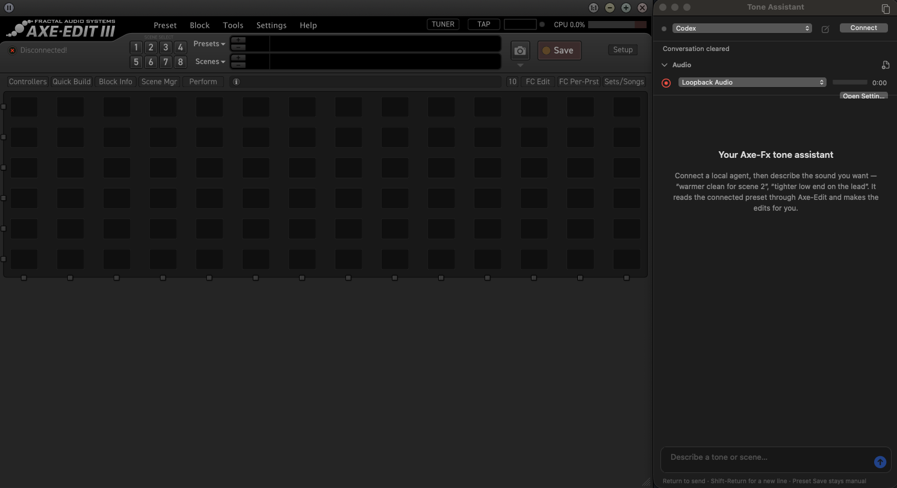

# Axe-Edit Tone Assistant

A guitar-tone chat assistant docked to **Fractal Audio's Axe-Edit III**. It uses
the Codex or Claude CLI already logged in on your Mac. Describe the sound you
want, and the agent inspects the connected Axe-Fx III preset and changes knobs,
bypass, channels and scenes for you, through Axe-Edit itself.

It runs as a separately signed **copy** of Axe-Edit. Your installed Axe-Edit is
never modified.



*The installed app: Axe-Edit III on the left, Tone Assistant on the right.
This screenshot shows the disconnected state, before connecting an Axe-Fx
and starting an agent session.*

The panel brings these controls into the editor:

- **Codex / Claude selector and Connect:** start a conversation using your
  existing CLI login.
- **Audio:** select a recording input, record your guitar, or import reference
  clips for local audio analysis. The screenshot shows Loopback Audio selected;
  choose your Axe-Fx USB input when recording directly from the device.
- **Conversation and message field:** describe a tone, ask about the preset,
  or request an edit. Replies support fenced Markdown code blocks with
  monospaced text, a shaded background and language labels.
- **New chat and docking controls:** clear the conversation or detach the
  panel into its own window.

## Requirements

- macOS on Apple silicon.
- Axe-Edit III for Apple silicon. 1.15.03 is hand-verified; other builds are
  analysed automatically when patched (see Safety).
- Python 3 (`python3`) to run the installer.
- Xcode Command Line Tools: `xcode-select --install`.
- A logged-in [Codex](https://github.com/openai/codex) CLI (`codex login`), or
  Claude Code (`claude auth login`).

## Install

```sh
scripts/patch-axe-edit
```

### What the script does

`scripts/patch-axe-edit` builds and installs a separate desktop app from the
source in this repository. It requires an existing Axe-Edit III installation.

```text
Installed Axe-Edit III + this repository's source
                      |
              scripts/patch-axe-edit
                      |
       ~/Applications/Axe-Edit III Chat.app
          Axe-Edit III + Tone Assistant
```

1. **Finds the original editor** in `/Applications`, `~/Applications`, or
   Spotlight, or uses the app selected with `--app`.
2. **Checks compatibility** using the editor version and executable hash,
   then scans for the parameter-command path. For the hand-verified 1.15.03
   build, discovery must match the expected profile.
3. **Copies the app into a staging directory** and compiles the native chat,
   preset tools and audio tools into `AxeSidebarProof.dylib`.
4. **Adds a launcher to the copy** that loads this library when Axe-Edit
   starts. The original executable is retained inside the copy as
   `Axe-Edit III Original`.
5. **Stores the detected compatibility profile and installation metadata**,
   adds the microphone permission description, then signs the copy locally
   with an ad hoc signature and verifies it.
6. **Installs the result** as `~/Applications/Axe-Edit III Chat.app`. An
   existing patched copy is replaced only after confirmation or with `--force`.

The source Axe-Edit installation stays unchanged. Building does not launch
the editor or change a preset. Quit the regular Axe-Edit before opening the
chat-enabled copy so only one editor communicates with your Axe-Fx.

Re-run it after pulling changes; it asks before replacing the previous copy.

| Option | Effect |
| --- | --- |
| `--dry-run` | Check compatibility and report without building or installing |
| `--discover` | Print the detected parameter-command profile without installing |
| `--app PATH` | Use a specific Axe-Edit |
| `--output PATH` | Install somewhere else |
| `--force` | Replace without asking |
| `--yes` | Accept prompts |

## Use

1. **Launch:** quit the regular Axe-Edit (only one editor should talk to the
   Axe-Fx), then `open ~/Applications/"Axe-Edit III Chat.app"`.
2. **Connect:** the **Tone Assistant** panel docks to the editor's right edge.
   Choose Codex or Claude and press **Connect**.
3. **Ask:** for example *"warmer clean for scene 2"* or *"set Amp 1 gain to
   6"*. Return sends; Shift-Return starts a new line. The spinner shows while
   the agent works, and the round button stops it.
4. **Match a tone from audio:** open the **Audio** section under the status
   line.
   - **Import the reference:** click the file icon, or drop files onto it.
     Ideally use isolated guitar.
   - **Record your tone:** pick your input (the Axe-Fx III USB audio is
     preselected when present), press ● and play the same part. Each clip
     can be marked **Ref** or **Mine**.
   - **Ask the agent:** for example *"compare my tone to the reference"*. It
     measures both clips locally, explains the differences and proposes
     specific knob changes. It applies them only after you agree, then asks
     for a new take to compare again.
   - **Privacy:** audio never leaves your Mac; the agent sees only numeric
     measurements.
5. **Start over:** the pencil icon starts a new chat with a fresh agent
   session. Audio clips are kept.
6. **Arrange:** drag the panel's edge to widen it. The title-bar icon detaches
   it into a free window and docks it back.

## Safety

- **Knob changes are normal Axe-Edit edits.** They go through the same command
  as typing into a knob, so **⌘Z undoes them**. The agent never saves or stores
  presets; saving stays up to you.
- **Each build gets its own checked profile.** When patching, the script
  locates Axe-Edit's knob-change method in the program itself and stores the
  result in the copy, tied to that exact build's code hash. At startup the
  library refuses the profile if the code differs or the expected classes and
  method tables are not found in memory.
  - **1.15.03 (hand-verified):** knob changes work immediately; the patcher
    refuses to build if discovery ever disagrees with the verified values.
  - **Other builds:** the remaining memory offsets are learned from the visible
    knobs and accepted only if they match Axe-Edit's own firmware definitions.
    Knob changes stay off until you enable them once from the yellow line in
    the panel (remembered for that build). If discovery or calibration fails,
    chat and inspection still work, but knob changes stay disabled.
- **Every write is checked first and read back after.** Each write requires
  the current value and a range verified against Axe-Edit's own firmware
  definitions. Model selection and list parameters are refused.
- **Effect bypass uses the native toggle on the verified 1.15.03 build.**
  Both the bypass button and grid block must report the requested state.
  Other builds report bypass unavailable; the assistant does not fall back
  to an accessibility press that may be accepted without changing the effect.
- **Chat stays local.** It goes only to your local CLI's normal service.
  History is kept in `~/Library/Application Support/AxeStudioEmbeddedChat/`.

## Development

```sh
scripts/test                 # fixture tests, no Axe-Edit or hardware needed
scripts/patch-axe-edit       # rebuild and reinstall the copy
```

Logs are in `~/Library/Logs/AxeEditSidebarProof.log`.

macOS asks for microphone permission the first time you record. Re-running
the patcher re-signs the copy, so macOS may ask again.

## External Software

| Dependency | Version / source | Purpose |
| --- | --- | --- |
| Axe-Edit III | Fractal Audio Systems; 1.15.03 is hand-verified | Provides the editor copied by the installer and the connection to Axe-Fx III |
| Python | Python 3; `python3` on your Mac | Runs the installer and discovery scripts using the standard library |
| Xcode Command Line Tools | Apple; installed with `xcode-select --install` | Provides Clang and the macOS SDK for compiling the native library |
| macOS tools and frameworks | Apple; system-provided | Copies and signs the app; provides native UI, recording and audio analysis |
| Codex CLI or Claude Code | [OpenAI Codex](https://github.com/openai/codex) or [Claude Code](https://github.com/anthropics/claude-code); installed and logged in separately | Runs the selected agent; no specific CLI version is pinned by the installer |

## Uninstall

Delete `~/Applications/Axe-Edit III Chat.app`. Optionally also delete
`~/Library/Application Support/AxeStudioEmbeddedChat/`, which holds chat
history and audio clips.

This project is not affiliated with Fractal Audio Systems.
